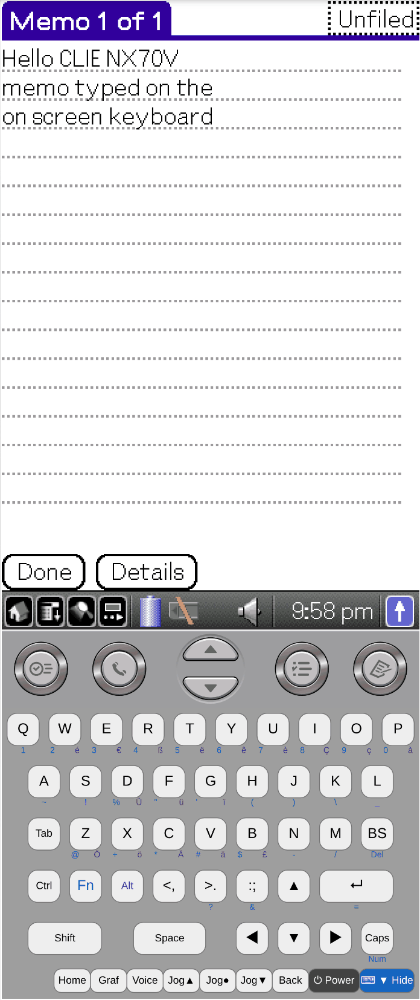
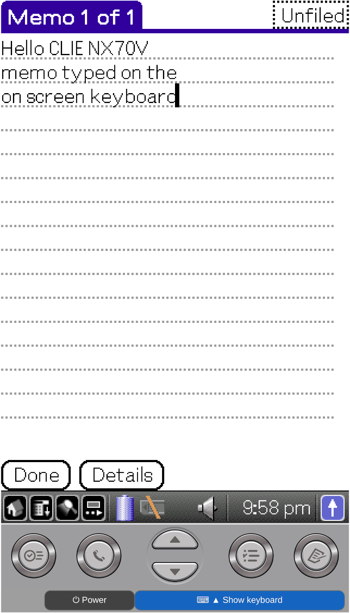

# CloudpilotEmu — Sony CLIÉ PEG-NX70V investigation branch

> **Experimental.** NX70V work and tests happen on this branch; finished changes go to [`master`](https://github.com/muns5965/cloudpilot-emu), which deploys the browser version. NX70V also runs in the browser at **[muns5965.github.io/cloudpilot-emu](https://muns5965.github.io/cloudpilot-emu/)** (see [Browser](#browser); TG50 runs there too). The native build has an `--nx70v` mode: NX70V Palm OS completes Setup (with pen calibration) and reaches the CLIÉ Launcher. Because the known dump lacks the small boot ROM, it still borrows the boot ROM of a TG50 NOR image at run time (`--boot-rom`). This branch was created from [`feature/sony-tg50`](https://github.com/muns5965/cloudpilot-emu/tree/feature/sony-tg50) and uses its TG50 code (the `--tg50` path and the TG50 device models) as the base. NX70V reuses the TG50 peripheral code and keeps four device-specific settings ([TG50 and NX70V differences](#tg50-and-nx70v-differences)). The TG50 model comes from the original [uARM](https://github.com/uARM-Palm/uARM); the original uARM has no NX70V model, so NX70V support is new.

[**NX70V notes**](docs/sony-nx70v-port.md) · [**TG50 branch README**](https://github.com/muns5965/cloudpilot-emu/blob/feature/sony-tg50/README.md) · [**TG50 technical notes**](docs/sony-tg50-port.md) · [**Original CloudpilotEmu README**](doc/README-upstream.md) · [**Upstream repository**](https://github.com/cloudpilot-emu/cloudpilot-emu)

## Screenshot

Browser build (`master` 0fd3d89) in Chromium: Memo typed with the on-screen keyboard, then folded with **⌨ ▼ Hide**.

| On-screen keyboard | Keyboard hidden |
| --- | --- |
|  |  |

## Status (2026-10-23)

NX70V ROM: Palm OS 5.0, Sony, HAL ID `crdb`, 12 MiB. Not included in this repository. Status: **works (where)** = implemented and tested in the environment named (native = Linux build, browser = this fork's web version); **untested** = implemented, not tested there; **in development**; **not implemented** / known limit.

| Item | Status | Notes |
| --- | --- | --- |
| ROM header | **Parsed** | Header at `0x20000`; checked by `tools/probe-nx70v-rom.py` |
| ROM as dumped | **Does not boot** | `0x0`–`0x1FFFF` is device data (with a serial-like value), not the small boot ROM that TG50 has at `0x0`. The main ROM's own loader copy then calls code that was never copied and loops |
| `--nx70v --boot-rom <TG50 NOR>` | **Setup with pen calibration → CLIÉ Launcher** | The TG50 boot ROM (`0x0`–`0x17FFF`) is copied over the device data in memory only; no file is changed |
| `0x10000000` (CS4) | **CF slot controller** (Sony CfSlot Library) | Unemulated writes caused the reboot loop. Minimal model: status `+0x10` = `0xC0` (no card), other registers accept writes |
| `0x14000000` | Same Memory Stick controller as TG50 | |
| Sony microcontroller | Same as TG50 (ID `0x4741`) | |
| Display | **320×480** (TG50: 320×320) | The ROM draws its own virtual Graffiti area and status bar |
| Touch | **Works** (native, browser) | Same AD7873 chip and pen interrupt (GPIO9) as TG50. It was blocked because the TG50 microcontroller model reports the NX70V HOLD switch (port A bit `0x10`) as on. X and Y are inverted versus TG50 |
| Keyboard | **Works** (native, browser) | Same key table as TG50; fast typing (40 ms per key, repeated letters) is correct since keys are held for at least ~100 ms. PC digit keys (row and numpad) type `1`–`0` (sent as Fn + top row); holding a key repeats. Fast typing, digit keys and key repeat were tested natively; the browser test covered the on-screen keyboard |
| Hard buttons | **Works** (native): F1 Date Book, F2 Address, F3 To Do, F4 Memo (factory setting per the NX70V manual, p. 45) | The first press after boot used to be lost (shared with TG50; fixed by swapping the controller's edge-detect registers) |
| Apps | **Works** (native): CLIÉ Album, Calculator, Memo Pad tested | Calculator `1 + 3 =` by taps gives 4 |
| Power key (Esc), sleep/resume | **Works** (native) | Shared with TG50: Esc sleeps (screen off), Esc again wakes; keyboard works after resume. A Date Book alarm wakes it and shows the Reminder (native) |
| Browser | **Boots** (user test on a phone): Date Book, virtual Graffiti area; on-screen keyboard typing incl. Fn (`2`), Alt (`é`), Shift (`>`) | Device `PEG-NX70V`, TG50 ROM as boot ROM in the session settings, on-screen keyboard with the NX70V layout |
| Session files | **Works** (native); browser **untested** | Shared with TG50: `save-session <file>`, then start the emulator with the session file (no `--nx70v`/`--boot-rom` needed); also while asleep |

## TG50 and NX70V differences

The emulator implements the NX70V on the TG50 device model and separates these four settings by device (`--nx70v`, or a session whose device is `PEG-NX70V`). The values describe the emulator's implementation; they do not mean these are the only hardware differences between the two devices.

| # | Item | TG50 | NX70V | Implemented in |
| --- | --- | --- | --- | --- |
| 1 | `0x10000000` (CS4) | Unused (no device) | Minimal CF slot controller model: status `+0x10` = `0xC0` (no card), other registers accept writes | `deviceSonyTG50.cpp` `nx70vCfSlotAccess`, `sony_tg50_hardware.h` |
| 2 | Display | 320×320 | 320×480 | `device_configuration.cpp` |
| 3 | Sony controller port A bit `0x10` (HOLD switch) | 1 ("HOLD off" on the TG50) | 0 (opposite polarity: "HOLD off" on the NX70V) | `deviceSonyTG50.cpp`, `sony_tg50_hardware.h` |
| 4 | Pen coordinates → touch chip raw values | 320×320 converted directly (`3200 − 10 × coordinate`) | X and Y inverted, 480 lines scaled into the TG50's 320-line range, then the same conversion | `deviceSonyTG50.cpp` `sonyTG50Touch` |

The device is selected by one flag, `sonyTG50Initialize(…, nx70v)`. The TG50 value in row 3 is the setting in the code; the controller's actual power-on value was not dumped.

## Known limits

- **Boot ROM**: the NX70V dump at hand has no separate boot ROM, so the boot ROM of a TG50 NOR image (`0x0`–`0x17FFF`) is used at run time (`--boot-rom`; in the browser, set in the session settings). No further dump is planned. A future NX70V dump that includes its own boot ROM (header at `0x0`) is expected to run without a boot ROM setting, but that configuration has not been tested.
- **Not implemented**: the CF card itself (per the manual the slot only takes a CF network card such as PEGA-WL100; a dummy card ships in it), and the flip and HOLD switches as user controls.

## Next

1. Browser: session save and restore (boot and the on-screen keyboard incl. Fn, Alt and Shift are confirmed).
2. CF network card support (low priority, the slot takes no memory cards).

## Browser

1. Open **https://muns5965.github.io/cloudpilot-emu/**. ROM files stay in your browser.
2. **Sessions → +**, choose the NX70V ROM. The device shows as **Sony PEG-NX70V** (320×480, 17 MB).
3. In the settings dialog, tap **Boot ROM (TG50 ROM, required)** and choose a TG50 NOR ROM. Its first 0x18000 bytes are copied over the start of the NX70V ROM in this browser only.
4. Save, select the session and press ▶. Setup and calibration as on the device.

On-screen keyboard: NX70V layout (positions measured on a device photo; keys drawn as plain shapes). Tap **Fn**, **Alt**, **Shift** or **Ctrl** to latch it for the next key. Blue characters: Fn, purple: Alt, as the European NX70V ROM types them. PC keys are the same as for the TG50 (F7 = Fn, F9 = Alt). the blue **⌨ ▼ Hide** key (end of the bottom row) folds the keyboard away so the screen gets larger; **⌨ ▲ Show keyboard** brings it back. **⏻ Power** (next to it, also on the folded strip) sleeps and wakes the device like Esc.

Do not export or share NX70V sessions: they contain the TG50 boot ROM.

## Running (native)

See the TG50 branch README for building:

```sh
./src/uarm/cp-uarm --nx70v --boot-rom /path/to/TG50-ROM.bin /path/to/nx70v.rom
```

- Without `--boot-rom`, `--nx70v` stops with a message, because the known dump has device data at `0x0`. Starting it with `--tg50` stops at `Invalid instr 0x56514b30 at 0x0001800c`.
- Window: 320×480. The pen calibration targets are at the screen corners; tap them in Setup.
- Check a ROM header: `python3 tools/probe-nx70v-rom.py /path/to/nx70v.rom`. For building and running TG50, see the [TG50 branch README](https://github.com/muns5965/cloudpilot-emu/blob/feature/sony-tg50/README.md).

**Never commit or publish** NX70V or TG50 ROM files, the device data area at `0x18000`, or NX70V session files (a session stores the whole ROM image as running, including the TG50 boot ROM copied in by `--boot-rom`).

---

# CloudpilotEmu — Sony CLIÉ PEG-NX70V 조사 브랜치

> **실험 단계입니다.** NX70V 작업과 시험은 이 브랜치에서 하고, 마친 변경은 브라우저 버전을 배포하는 [`master`](https://github.com/muns5965/cloudpilot-emu)로 합칩니다. NX70V는 브라우저 **[muns5965.github.io/cloudpilot-emu](https://muns5965.github.io/cloudpilot-emu/)** 에서도 실행됩니다([브라우저 실행](#브라우저-실행) 참고, TG50도 같은 주소). 네이티브 빌드에 `--nx70v` 모드가 있으며, NX70V Palm OS가 펜 보정을 포함한 Setup을 마치고 CLIÉ 런처까지 들어갑니다. 알려진 덤프에 작은 부트 ROM이 없어서, 실행할 때 TG50 NOR 이미지의 부트 ROM을 빌려 씁니다(`--boot-rom`). 이 브랜치는 [`feature/sony-tg50`](https://github.com/muns5965/cloudpilot-emu/tree/feature/sony-tg50)에서 갈라져 나왔고, 그 TG50 코드(`--tg50` 실행 경로와 TG50 장치 모델)를 바탕으로 씁니다. NX70V는 TG50 장치 코드를 그대로 쓰고 기종별 설정 4가지만 따로 둡니다([TG50과 NX70V의 차이](#tg50과-nx70v의-차이)). TG50 모델은 원본 [uARM](https://github.com/uARM-Palm/uARM)에서 이식했고, 원본 uARM에는 NX70V 모델이 없어 NX70V 지원은 새로 만든 것입니다.

[**NX70V 조사 기록(영문·한국어)**](docs/sony-nx70v-port.md) · [**TG50 브랜치 README**](https://github.com/muns5965/cloudpilot-emu/blob/feature/sony-tg50/README.md) · [**TG50 기술 문서(영문)**](docs/sony-tg50-port.md) · [**CloudpilotEmu 기존 README(영문)**](doc/README-upstream.md) · [**원본 저장소**](https://github.com/cloudpilot-emu/cloudpilot-emu)

## 실행 화면

브라우저 빌드(`master` 0fd3d89)를 Chromium에서 실행: 화면 키보드로 메모 입력 후 **⌨ ▼ Hide** 로 접은 모습.

| 화면 키보드 | 키보드 접음 |
| --- | --- |
|  |  |

## 현황(2026-10-23)

NX70V ROM: Palm OS 5.0, Sony, HAL ID `crdb`, 12MiB. 저장소에 포함하지 않습니다. 상태 표기: **동작(환경)** = 구현하고 적힌 환경에서 시험함(네이티브 = Linux 빌드, 브라우저 = 이 포크의 웹 버전) · **미검증** = 구현했으나 그 환경에서 시험하지 않음 · **개발 중** · **미구현**·알려진 제약.

| 항목 | 상태 | 비고 |
| --- | --- | --- |
| ROM 헤더 | **인식** | `0x20000`에 헤더. `tools/probe-nx70v-rom.py`로 확인 |
| 덤프 그대로 | **부팅 안 됨** | `0x0`~`0x1FFFF`가 기기 데이터(일련번호 성격 값 포함)이고, TG50의 `0x0`에 있는 작은 부트 ROM이 없음. 본 ROM 안의 부트 사본이 복사되지 않은 코드를 불러 무한 반복 |
| `--nx70v --boot-rom <TG50 NOR>` | **펜 보정 포함 Setup → CLIÉ 런처** | TG50 부트 ROM(`0x0`~`0x17FFF`)을 메모리에서만 기기 데이터 위에 덮어씀. 파일은 바꾸지 않음 |
| `0x10000000`(CS4) | **CF 슬롯 컨트롤러**(Sony CfSlot Library) | 에뮬레이트되지 않은 쓰기가 재부팅 반복의 원인. 최소 모델: 상태 `+0x10` = `0xC0`(카드 없음), 나머지 쓰기 수용 |
| `0x14000000` | TG50과 같은 메모리스틱 컨트롤러 | |
| Sony 마이컴 | TG50과 같음(ID `0x4741`) | |
| 화면 | **320×480**(TG50은 320×320) | ROM이 가상 그래피티 영역과 상태 표시줄을 직접 그림 |
| 터치 | **동작**(네이티브, 브라우저) | 터치 칩(AD7873)과 펜 인터럽트(GPIO9) 모두 TG50과 같음. TG50 마이컴 모델이 NX70V HOLD 스위치(포트 A 비트 `0x10`)를 켜짐으로 알려 막혀 있었음. X·Y가 TG50과 반대 |
| 키보드 | **동작**(네이티브, 브라우저) | 키 표가 TG50과 같음. 키를 최소 약 100ms 눌린 상태로 유지하도록 고쳐 빠른 입력(키당 40ms, 반복 글자)도 정확. PC 숫자 키(윗줄·숫자패드)로 `1`~`0` 입력(Fn + 윗줄로 전달), 누르고 있으면 반복 입력. 빠른 입력·숫자 키·반복 입력은 네이티브에서 시험했고, 브라우저 시험은 화면 키보드 범위 |
| 하드 버튼 | **동작**(네이티브): F1 일정(Date Book), F2 주소록, F3 할 일, F4 메모장(NX70V 매뉴얼 45쪽의 기본 설정) | 부팅 후 첫 누름이 무시되던 문제(TG50과 공통)는 마이컴 엣지 감지 레지스터를 바로잡아 해결 |
| 앱 | **동작**(네이티브): CLIÉ 앨범, 계산기, 메모장 시험 | 계산기에서 탭으로 `1 + 3 =` → 4 |
| 전원 키(Esc), 절전·복귀 | **동작**(네이티브) | TG50과 공통: Esc로 절전(화면 꺼짐), 다시 Esc로 복귀. 복귀 후 키보드 정상. Date Book 알람 시각에 저절로 켜져 알림 표시(네이티브) |
| 브라우저 | **부팅 확인**(휴대폰 사용자 시험): 일정(Date Book), 가상 그래피티 영역. 화면 키보드 입력 확인(Fn → `2`, Alt → `é`, Shift → `>`) | 기종 `PEG-NX70V`, 세션 설정에서 TG50 ROM을 부트 ROM으로 지정, NX70V 배열 화면 키보드 |
| 세션 파일 | **동작**(네이티브), 브라우저 **미검증** | TG50과 공통: `save-session <파일>` 후 세션 파일로 실행(`--nx70v`·`--boot-rom` 불필요). 절전 중 저장도 가능 |

## TG50과 NX70V의 차이

NX70V는 현재 에뮬레이터에서 TG50 장치 모델을 기반으로 구현하며, 다음 네 가지 설정을 기종별로 구분합니다(`--nx70v`로 실행하거나 세션의 기종이 `PEG-NX70V`일 때). 아래 값은 현재 에뮬레이터 구현 기준이며, 실제 두 기기의 하드웨어 차이가 이 네 가지뿐이라는 뜻은 아닙니다.

| # | 항목 | TG50 | NX70V | 구현 위치 |
| --- | --- | --- | --- | --- |
| 1 | `0x10000000`(CS4) | 쓰지 않음(장치 없음) | CF 슬롯 컨트롤러 최소 모델: 상태 `+0x10` = `0xC0`(카드 없음), 나머지 쓰기 수용 | `deviceSonyTG50.cpp` `nx70vCfSlotAccess`, `sony_tg50_hardware.h` |
| 2 | 화면 | 320×320 | 320×480 | `device_configuration.cpp` |
| 3 | Sony 마이컴 포트 A 비트 `0x10`(HOLD 스위치) | 1(TG50에서 "HOLD 꺼짐") | 0(극성이 반대라 NX70V에서 "HOLD 꺼짐") | `deviceSonyTG50.cpp`, `sony_tg50_hardware.h` |
| 4 | 펜 좌표 → 터치 칩 원시값 | 320×320을 그대로 변환(`3200 − 10×좌표`) | X·Y를 반대로 하고 480줄을 TG50의 320줄 범위로 축소한 뒤 같은 변환 | `deviceSonyTG50.cpp` `sonyTG50Touch` |

기종 구분은 `sonyTG50Initialize(…, nx70v)` 플래그 하나로 합니다. 3번 TG50 값은 코드의 설정 기준이며, 실제 마이컴 초기값을 따로 덤프해 확인하지는 않았습니다.

## 알려진 제약

- **부트 ROM**: 현재 확보한 NX70V 덤프에는 별도의 부트 ROM이 없어, 실행 시 TG50 NOR 이미지의 부트 ROM(`0x0`~`0x17FFF`)을 사용합니다(`--boot-rom`, 브라우저는 세션 설정에서 지정). 현재 추가 덤프 계획은 없습니다. 향후 자체 부트 ROM이 포함된 NX70V 덤프(`0x0`에 헤더)를 확보하면 별도 부트 ROM 지정 없이 실행할 수 있을 것으로 예상되나, 해당 구성은 아직 시험하지 않았습니다.
- **미구현**: CF 카드 자체(매뉴얼상 이 슬롯은 PEGA-WL100 같은 CF 네트워크 카드 전용이고 출고 때 빈 보호 카드가 꽂혀 있음), 접힘·HOLD 스위치 조작.

## 다음 단계

1. 브라우저에서 세션 저장·복원 시험(부팅 및 Fn·Alt·Shift를 포함한 화면 키보드는 확인됨)
2. CF 네트워크 카드 지원 검토(메모리 카드를 받지 않는 슬롯이라 우선순위 낮음)

## 브라우저 실행

1. **https://muns5965.github.io/cloudpilot-emu/** 를 엽니다. ROM 파일은 브라우저 안에서만 쓰입니다.
2. **Sessions → +** 에서 NX70V ROM을 고릅니다. 기종 **Sony PEG-NX70V**(320×480, 17MB)로 표시됩니다.
3. 설정 창의 **Boot ROM (TG50 ROM, required)** 칸을 눌러 TG50 NOR ROM을 고릅니다. 그 앞 0x18000바이트를 이 브라우저 안에서만 NX70V ROM 앞부분에 덮어씁니다.
4. 저장한 뒤 세션을 선택하고 ▶를 누릅니다. Setup과 펜 보정은 실기와 같습니다.

화면 키보드: NX70V 배열(실기 사진에서 위치를 측정, 키는 단순 도형으로 그림). **Fn**, **Alt**, **Shift**, **Ctrl**을 탭하면 다음 키 한 번에 적용됩니다. 파란 글자는 Fn, 보라 글자는 Alt로, 유럽판 NX70V ROM이 실제로 내는 글자입니다. PC 키는 TG50과 같습니다(F7 = Fn, F9 = Alt). 맨 아래 줄 끝의 파란 **⌨ ▼ Hide** 키로 키보드를 접으면 화면이 커지고, **⌨ ▲ Show keyboard** 로 다시 폅니다. 그 옆의 **⏻ Power**(접은 줄에도 있음)는 Esc처럼 절전·복귀를 합니다.

NX70V 세션은 TG50 부트 ROM을 포함하므로 내보내거나 공유하지 않습니다.

## 네이티브 실행

빌드 방법은 TG50 브랜치 README를 참고합니다.

```sh
./src/uarm/cp-uarm --nx70v --boot-rom /path/to/TG50-ROM.bin /path/to/nx70v.rom
```

- `--boot-rom` 없이 실행하면 안내 메시지와 함께 멈춥니다. 알려진 덤프의 `0x0`이 기기 데이터이기 때문입니다. `--tg50`으로 실행하면 `Invalid instr 0x56514b30 at 0x0001800c`에서 멈춥니다.
- 창 크기 320×480. Setup의 펜 보정 표적은 화면 모서리에 나옵니다.
- ROM 헤더 확인: `python3 tools/probe-nx70v-rom.py /path/to/nx70v.rom`. TG50 빌드·실행 방법은 [TG50 브랜치 README](https://github.com/muns5965/cloudpilot-emu/blob/feature/sony-tg50/README.md)를 보세요.

NX70V·TG50 ROM 파일, `0x18000`의 기기 데이터 영역, NX70V 세션 파일은 **절대 커밋·공개하지 않습니다**(세션은 `--boot-rom`으로 덮어쓴 TG50 부트 ROM을 포함한 실행 중 ROM 전체를 저장함).
