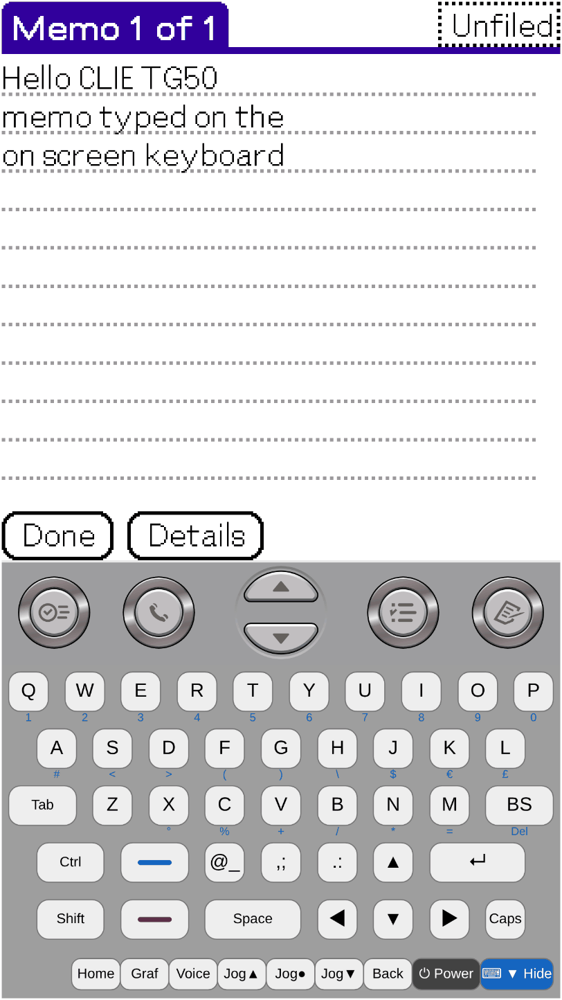
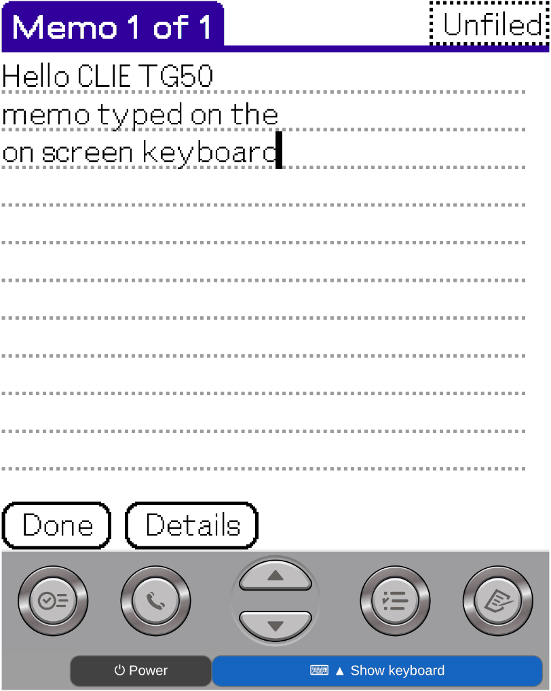

# CloudpilotEmu fork — Sony CLIÉ (Palm OS 5)

> **Experimental, unofficial fork** of [CloudpilotEmu](https://github.com/cloudpilot-emu/cloudpilot-emu): the Sony PEG-TG50 hardware model from the original [uARM](https://github.com/uARM-Palm/uARM), ported and adapted to CloudpilotEmu's Palm OS 5 (uARM) engine, plus PEG-NX70V support, which the original uARM does not have. This is **not an official CloudpilotEmu release**. No ROM is included; bring your own.

[한국어](#cloudpilotemu-포크--sony-clié-palm-os-5)

## Try it in the browser

**[muns5965.github.io/cloudpilot-emu](https://muns5965.github.io/cloudpilot-emu/)** — Sony PEG-TG50 and PEG-NX70V. Open **Sessions → +** and choose your ROM; the device is detected from it. For the NX70V, the settings dialog also asks for a TG50 ROM, which supplies the missing boot ROM. ROM files stay in your browser.

## Screenshots

Browser build of `master` (revision 0fd3d89) in Chromium: Memo typed with the on-screen keyboard (Shift for capitals, Blue/Fn for digits), then the keyboard folded with **⌨ ▼ Hide** (**⌨ ▲ Show keyboard** brings it back).

| PEG-TG50 | PEG-TG50 (keyboard hidden) | PEG-NX70V | PEG-NX70V (keyboard hidden) |
| --- | --- | --- | --- |
|  |  |  |  |

## Branches

Status: **works (where)** = implemented and tested in the environment named; **untested** = implemented, not tested there; **in development**; **not implemented** / known limit.

| Branch | Device | Browser | Native Linux | Android | Status |
| --- | --- | --- | --- | --- | --- |
| [`feature/sony-tg50`](https://github.com/muns5965/cloudpilot-emu/tree/feature/sony-tg50) | PEG-TG50 (Palm OS 5.0, 320×320, QWERTY keyboard) | **works** (phone and PC) | **works** | — (see `verify/android-apk`) | Native and browser: Setup, Launcher, touch, hard buttons, keyboard (PC keyboard in Chromium on a PC, on-screen keyboard on a phone). Native: apps, sleep/resume. Sessions: **works** natively and in the PC browser (Chromium); phone browser **untested**. Sound and Memory Stick media **not implemented** |
| [`feature/sony-nx70v`](https://github.com/muns5965/cloudpilot-emu/tree/feature/sony-nx70v) | PEG-NX70V (Palm OS 5.0, 320×480) | **boots** (phone test) | **works** | — | Native: Setup, Launcher, apps, PC keyboard, hard buttons, sleep/resume. Browser (phone): Setup with pen calibration, Date Book, on-screen keyboard (Fn, Alt, Shift). Sessions: **works** natively; browser **untested**. Limit: the known dump lacks the small boot ROM, so a TG50 ROM supplies it at run time (`--boot-rom`) |
| `master` | TG50 + NX70V | deployed from here | **works** | not merged | Integration branch: tested changes go here, and the browser version is built from it |
| `verify/android-apk` | PEG-TG50 | — | — | **in development** (arm64, Android 8 or later) | Tested on a phone (Android 17): boot, on-screen buttons, phone keyboard (Latin letters), session save and restore. **Untested** on a phone: PRC/PDB install. Not merged, no release (CI test builds only) |

Workflow: device-specific work and tests happen on the feature branches; finished changes are merged into `master`, which deploys the browser version. Fixes to shared code (emulator core, web input) go to `master` first and are merged into the feature branches. Each branch keeps its own README: when a feature branch merges `master` and the README conflicts, the feature branch's README is kept; changes to other files are reviewed and merged on their own. Details, keys and build steps: [TG50 README](https://github.com/muns5965/cloudpilot-emu/blob/feature/sony-tg50/README.md), [NX70V README](https://github.com/muns5965/cloudpilot-emu/blob/feature/sony-nx70v/README.md), technical notes in [docs/](docs/).

## Notes

- ROM files and session files are never committed or published.
- The upstream README (emulator overview, supported devices, build, license) is kept in [doc/README-upstream.md](doc/README-upstream.md). Upstream: [cloudpilot-emu/cloudpilot-emu](https://github.com/cloudpilot-emu/cloudpilot-emu). The TG50 hardware model is ported from [uARM](https://github.com/uARM-Palm/uARM); the NX70V support is new (uARM has no NX70V model).

---

# CloudpilotEmu 포크 — Sony CLIÉ (Palm OS 5)

> 원본 [uARM](https://github.com/uARM-Palm/uARM)의 Sony PEG-TG50 하드웨어 모델을 [CloudpilotEmu](https://github.com/cloudpilot-emu/cloudpilot-emu)의 Palm OS 5(uARM) 엔진에 이식해 맞추고, 원본 uARM에 없는 PEG-NX70V 지원을 더한 **실험용 비공식 포크**입니다. **공식 CloudpilotEmu 배포판이 아닙니다.** ROM은 포함하지 않으므로 직접 준비해야 합니다.

## 브라우저에서 실행

**[muns5965.github.io/cloudpilot-emu](https://muns5965.github.io/cloudpilot-emu/)** — Sony PEG-TG50, PEG-NX70V. **Sessions → +** 에서 ROM을 고르면 기종이 자동으로 인식됩니다. NX70V는 설정 창에서 빠진 부트 ROM을 채울 TG50 ROM을 하나 더 고릅니다. ROM 파일은 브라우저 안에서만 쓰입니다.

## 실행 화면

`master` 브라우저 빌드(리비전 0fd3d89)를 Chromium에서 실행한 화면입니다. 화면 키보드로 메모를 입력(대문자는 Shift, 숫자는 Blue/Fn)한 뒤 **⌨ ▼ Hide** 로 키보드를 접었습니다(**⌨ ▲ Show keyboard** 로 다시 펼침).

| PEG-TG50 | PEG-TG50 (키보드 접음) | PEG-NX70V | PEG-NX70V (키보드 접음) |
| --- | --- | --- | --- |
|  |  |  |  |

## 브랜치

상태 표기: **동작(환경)** = 구현하고 적힌 환경에서 시험함 · **미검증** = 구현했으나 그 환경에서 시험하지 않음 · **개발 중** · **미구현**·알려진 제약.

| 브랜치 | 기종 | 브라우저 | Linux 네이티브 | Android | 현황 |
| --- | --- | --- | --- | --- | --- |
| [`feature/sony-tg50`](https://github.com/muns5965/cloudpilot-emu/tree/feature/sony-tg50) | PEG-TG50(Palm OS 5.0, 320×320, QWERTY 키보드) | **동작**(휴대폰·PC) | **동작** | —(`verify/android-apk` 참고) | 네이티브·브라우저: Setup, 런처, 터치, 하드 버튼, 키보드(PC 키보드는 PC Chromium, 화면 키보드는 휴대폰에서 확인). 네이티브: 앱, 절전·복귀. 세션: 네이티브와 PC 브라우저(Chromium) **동작**, 휴대폰 브라우저 **미검증**. 소리·Memory Stick 카드 **미구현** |
| [`feature/sony-nx70v`](https://github.com/muns5965/cloudpilot-emu/tree/feature/sony-nx70v) | PEG-NX70V(Palm OS 5.0, 320×480) | **부팅 확인**(휴대폰 시험) | **동작** | — | 네이티브: Setup, 런처, 앱, PC 키보드, 하드 버튼, 절전·복귀. 브라우저(휴대폰): 펜 보정 포함 Setup, 일정(Date Book), 화면 키보드(Fn·Alt·Shift). 세션: 네이티브 **동작**, 브라우저 **미검증**. 제약: 알려진 덤프에 작은 부트 ROM이 없어 실행 때 TG50 ROM에서 빌려 씀(`--boot-rom`) |
| `master` | TG50 + NX70V | 여기서 배포 | **동작** | 합치지 않음 | 통합 브랜치: 시험을 마친 변경을 모으고, 브라우저 버전을 여기서 빌드 |
| `verify/android-apk` | PEG-TG50 | — | — | **개발 중**(arm64, Android 8 이상) | 휴대폰 실기 확인(Android 17): 부팅, 화면 버튼, 휴대폰 키보드(영문), 세션 저장·복원. 휴대폰 실기 **미검증**: PRC/PDB 설치. `master`에 합치지 않았고 배포하지 않음(CI 시험 빌드만) |

작업 방식: 기종별 작업과 시험은 각 기능 브랜치에서 하고, 마친 변경을 `master`에 합쳐 브라우저 버전을 배포합니다. 공통 코드(에뮬레이터 코어, 웹 입력) 수정은 `master`에서 먼저 하고 기능 브랜치로 받아 옵니다. README는 브랜치마다 따로 둡니다. 기능 브랜치에서 `master`를 병합할 때 README 충돌이 발생하면 해당 기능 브랜치의 README를 우선 유지하고, 다른 파일의 변경 사항은 별도로 검토하여 병합합니다. 자세한 내용, 키 연결, 빌드 방법: [TG50 README](https://github.com/muns5965/cloudpilot-emu/blob/feature/sony-tg50/README.md), [NX70V README](https://github.com/muns5965/cloudpilot-emu/blob/feature/sony-nx70v/README.md), 기술 문서는 [docs/](docs/).

## 참고

- ROM 파일과 세션 파일은 절대 커밋·공개하지 않습니다.
- 원본 README(에뮬레이터 소개, 지원 기종, 빌드, 라이선스)는 [doc/README-upstream.md](doc/README-upstream.md)에 보존했습니다. 원본 저장소: [cloudpilot-emu/cloudpilot-emu](https://github.com/cloudpilot-emu/cloudpilot-emu). TG50 하드웨어 모델은 [uARM](https://github.com/uARM-Palm/uARM)에서 이식했고, NX70V 지원은 새로 만든 것입니다(uARM에는 NX70V 모델이 없음).
